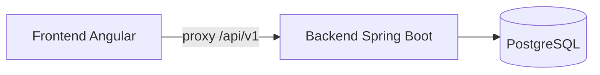

# Architecture

La forme technique macro : la stack, comment les pièces s'assemblent, et les décisions derrière. Pointer vers le code, pas le restater.

## Stack

- Backend : Spring Boot (Java 21, `backend/springboot`).
- Frontend : Angular (standalone), Tailwind CSS, RxJS — `frontend/`.
- Base de données : PostgreSQL, migrations Liquibase (côté Spring Boot).

## Comment ça s'assemble

Le frontend Angular appelle le backend choisi via un proxy (`proxy.conf.json`), qui expose l'API `/api/v1` au-dessus de PostgreSQL.

## Décisions clés

- Backend unique : Spring Boot. Tout changement d'API métier se fait dans `backend/springboot`.
- Architecture hexagonale : `application` (dao, service), `domain`, `infrastructure`.
