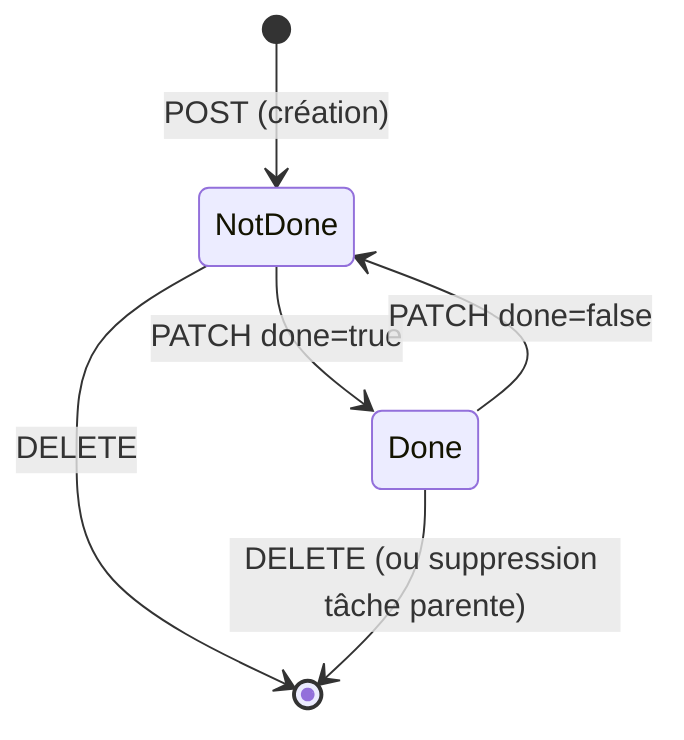
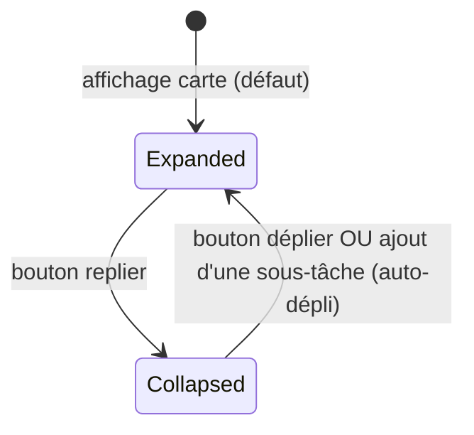

# Data Model: Sous-tâches et progression des tâches

Feature: `specs/001-task-subtasks-progress/spec.md` — Phase 1

## Entities

### Task (existatif, impacté)

Agrégat principal. Peut posséder zéro à 50 sous-tâches. Sa progression est dérivée, jamais stockée.

| Champ | Type | Règles |
|-------|------|--------|
| id | bigint | PK existante |
| ... champs existants | — | inchangés (titre, statut, assignation, etc.) |
| subtasks | 0..50 Subtask | relation 1-N, cascade `ON DELETE CASCADE` |

**Relations**: `Task 1 ── 0..50 Subtask`. Une sous-tâche appartient à exactement une tâche.

**Suppression**: supprimer une tâche supprime ses sous-tâches (FK cascade) — spec Edge Case.

### Subtask (nouveau)

| Champ | Type | Règles / Validation |
|-------|------|---------------------|
| id | bigint (BIGSERIAL) | PK |
| task_id | bigint | FK → `task(id)`, NOT NULL, `ON DELETE CASCADE` ; pas de parent sous-tâche (pas de colonne `parent_subtask_id`) |
| title | varchar(200) | NOT NULL ; non vide (FR-011) ; ≤ 200 caractères (FR-011) ; doublons autorisés au sein d'une tâche |
| done | boolean | NOT NULL, défaut `false` (FR-005) |
| created_at | timestamptz | NOT NULL, défaut `now()` ; ordre d'affichage `created_at, id` (ordre de création, pas de réordonnancement) |

**Validation** (backend Jakarta + service, frontend miroir) :
- `title` : non vide après trim, longueur ≤ 200 → sinon refus avec message clair (400)
- `task_id` : doit référencer une tâche existante → sinon 404 (ex. parent supprimé pendant formulaire ouvert)
- nombre de sous-tâches de la tâche < 50 à la création → sinon 409 avec message limite atteinte (FR-012)

## Valeur dérivée : Progression

Calculée à la volée, jamais persistée :

```
progress = subtasks.isEmpty() ? null (aucune barre) 
         : Math.round(doneCount * 100.0 / subtasks.size())
```

- Tâche sans sous-tâche → progression inapplicable, aucune barre (FR-009, US1 scénario 6)
- Toutes terminées → 100 % ; cas 1 sous-tâche → 0 % ou 100 % uniquement (Edge Case)
- Arrondi à l'entier le plus proche : 1/3 → 33 % (Edge Case)
- Recalculée à chaque ajout / changement d'état / suppression de sous-tâche (FR-008)

## State transitions

### Subtask.done



Pas d'autre transition : pas de statut intermédiaire, pas de réordonnancement.

### Cycle de vie de la liste (UI)



L'état replié n'est pas persisté : rechargement → `Expanded` (spec).

## Changelog Liquibase prévu

`backend/springboot/src/main/resources/db/changelog/003-add-subtasks.sql` :

- création table `subtask` (colonnes ci-dessus)
- FK `subtask.task_id → task.id` avec `ON DELETE CASCADE`
- index sur `subtask.task_id`
- inclusion dans `db.changelog-master.yaml`

Détail complet du contrat d'API : `specs/001-task-subtasks-progress/contracts/subtasks-api.md`.
